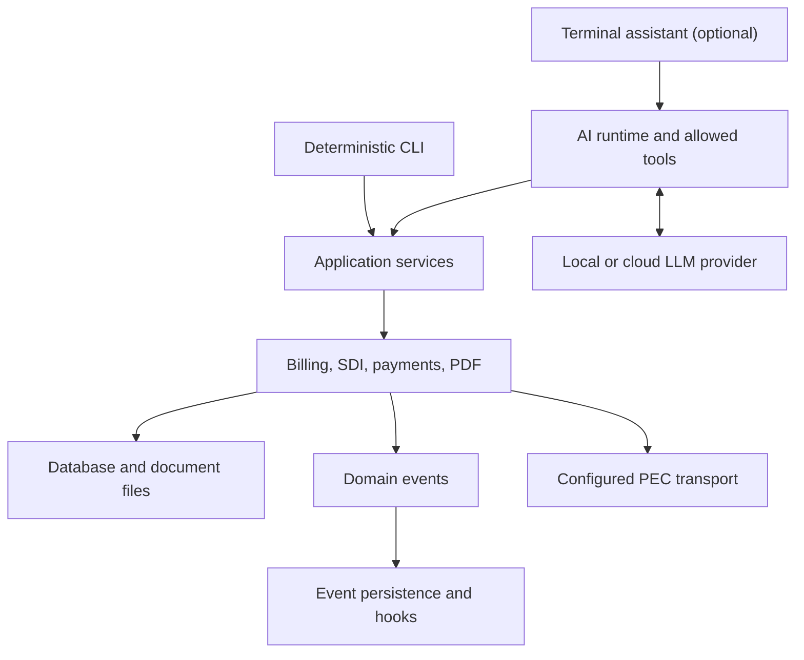

# OpenFatture

**Open-source electronic invoicing for Italy.**

A local-first, CLI-first invoicing workspace for Italian freelancers and small
businesses. Generate FatturaPA invoices, manage financial workflows, and automate
repetitive tasks with optional AI assistance. Your data remains under your control.

[](https://github.com/gianlucamazza/openfatture/actions/workflows/test.yml)
[](pyproject.toml)
[](LICENSE)

[Quick start](#quick-start) · [Capabilities](#what-you-can-do) ·
[Feature status](#feature-status) · [Documentation](#documentation) ·
[Issues](https://github.com/gianlucamazza/openfatture/issues)

## Why OpenFatture?

Italian electronic invoicing involves more than producing a PDF: structured XML,
customer records, delivery notifications, and payment tracking must fit together.
OpenFatture brings these workflows into a terminal workspace you can inspect and
extend.

- **Work locally.** Keep the default SQLite database and generated documents on
  your machine. Invoice calculations, XML generation, and PDF rendering do not
  require an LLM or a cloud account.
- **Choose how to work.** Use deterministic client and invoice commands, or add an
  assistant that calls application services through registered tools.
- **Automate around your workflow.** Reuse domain services, CSV and bank imports,
  domain events, and user hook scripts.

Built for freelancers and small studios comfortable in a terminal. This repository
has **no browser frontend or web application surface**; it is distinct from
OpenFatture Cloud.

## Quick Start

Requires **Python 3.12+**, Git, and [uv](https://docs.astral.sh/uv/).
Start with the core install; AI, retrieval, and forecasting are separate extras.

```bash
git clone https://github.com/gianlucamazza/openfatture.git
cd openfatture
uv sync --frozen
uv run openfatture init
uv run openfatture status
```

The setup wizard creates local storage and collects company settings. Use your
actual fiscal details and tax regime; AI configuration can be skipped.
`status --json` reports local readiness and next steps, without contacting providers
or verifying SDI delivery.

### Create a draft and preview it

Invoices, clients, PDFs and collections are handled by the assistant (`ai`
extra and a configured provider). Every change to your data shows its
parameters and asks for your confirmation first; sending to SDI is off. For a
consultation-only assistant set `ai_tool_access = "standard"` (lookups and
documents) or `"read"`.

```bash
uv run openfatture -m "Crea il cliente Demo Client, P.IVA 12345678903"
uv run openfatture -m "Crea una bozza per Demo Client: 3 ore di consulenza a 90 euro, IVA 22%"
uv run openfatture -m "Genera il PDF della bozza appena creata"
```

The PDF is a courtesy copy in `data_dir/exports/fatture/`; nothing is
transmitted. The VAT rate is illustrative. Complete and verify both issuer and
customer fiscal details before preparing a real invoice.

Explore the current command surface with `uv run openfatture --help`.

## What You Can Do

| Domain | Examples | Entry point |
| --- | --- | --- |
| Clients and invoices | Create clients, add invoice lines, inspect totals and draft status | Assistant tools |
| Documents | Render PDF courtesy copies and yearly summaries, create linked TD04 credit notes | Assistant tools |
| FatturaPA XML | Generate the XSD-validated XML file of an invoice in the archive | Assistant tools |
| Delivery | Send XML through a configured PEC account and process SDI notification files | SDI services; opt-in assistant tools |
| Payments | Import bank statements and reconcile transactions with payments | Payment services; assistant tools |
| Business workflows | Quotes, product records, CSV import/export, batch updates, and reports | Application services; assistant tools |
| Automation | React to domain events with scripts and inspect persisted event records | Events and hooks; [hook examples](examples/hooks/) |

Core capabilities live in application/domain packages and are exposed as
assistant tools. The CLI does not duplicate them: besides setup and diagnostics
it keeps only the SDI journal and the resolutions that need a person's evidence.

**The XML file is always validated.** The `generate_invoice_xml` assistant tool
writes the file to the archive only when it passes the FatturaPA XSD; XSD
validity is still not evidence of SDI acceptance.
See [XSD validation](docs/XSD_VALIDATION.md).

## AI-Assisted Workflows

Install only the assistant stack when you need natural-language access:

```bash
uv sync --frozen --extra ai
```

Configure `AI_PROVIDER`, `AI_MODEL`, and the provider credential or local endpoint
using the [configuration guide](docs/CONFIGURATION.md). Supported provider
adapters are OpenAI, Anthropic, and Ollama. Ollama requires a running local service
and an installed model; the extra does not install either.

Once configured, start with read-only requests:

```bash
uv run openfatture status --json
uv run openfatture -m "List my clients"
uv run openfatture -m "Show invoice 1 and its line items"
uv run openfatture
```

The assistant interprets the request; registered tools call application services
for business operations. Model responses are not proof that an operation ran:
inspect tool outcomes and the resulting records or files. Review fiscal inputs
and results yourself.

Tool access is controlled by `AI_TOOL_ACCESS`: `read` (lookups), `standard`
(default: lookups plus PDF and CSV files in `data_dir/exports`) or `full` (also
creation, reconciliation and other record changes, each confirmed by a person).
**No level enables SDI/PEC send**: sending requires naming `send_invoice_to_sdi`
in `AI_ENABLED_TOOLS`.

`AI_TOOLS_REQUIRE_CONFIRMATION=true` is the default. Tools marked as requiring
confirmation need human approval: a terminal can prompt, while noninteractive
callers without approval are refused. The model cannot approve itself. Turning
this setting off skips confirmation but still requires transmit-tool opt-in.
See [AI architecture](docs/AI_ARCHITECTURE.md) for runtime details.

## Architecture



The CLI and AI tools route business operations through application services.
Core storage, billing, payment, SDI, and PDF modules
remain usable without optional model dependencies.
See [architecture](docs/ARCHITECTURE.md) and
[core, extras, and extensions](docs/CORE_VS_EXTENSIONS.md).

## Data Ownership & Security

- **Persistence:** SQLite is the default; `DATABASE_URL`, `DATA_DIR`, and
  `ARCHIVIO_DIR` control storage. `init` writes a user profile; `status` shows
  configured paths. Persistent assistant sessions are also local files.
- **External data flow:** local-first does not mean every feature is offline.
  Cloud LLM requests can include prompts and tool results; PEC transmits invoice
  data. Choose providers and enabled tools accordingly.
- **Audit boundaries:** emitted domain events can be persisted to the database.
  This is an operational audit trail, not a tamper-proof archive or a guarantee
  that every action is durably recorded; persistence failures are logged without
  aborting the business operation.
- **Credentials and extensions:** protect local profiles, secrets, and signing
  material; never commit them. Diagnostic masking is not encryption at rest.
  Hook scripts execute local code and should be trusted before enabling them.
- **Retention:** back up the database and documents. A local document archive
  does not by itself establish compliant long-term preservation
  (*conservazione a norma*).

See the [configuration guide](docs/CONFIGURATION.md) and
[security policy](SECURITY.md) for settings and vulnerability reporting, and
[data that leaves the computer](docs/PRIVACY.md) for what the AI provider and
online lookups receive.

## Feature Status

The package identifies itself as **2.4.0**, with Beta metadata. These labels
describe implementation and dependencies, not certification or service guarantees.

| Capability | Status | Boundary |
| --- | --- | --- |
| Client and invoice CLI, PDF, FatturaPA XML, TD04 | Available in core | XML CLI generation does not run validation; fiscal inputs still need review |
| Bank import, reconciliation, quotes, batch, reports | Available in core services | Not all operations have direct CLI commands |
| PEC delivery and SDI notification processing | Implemented; configuration required | Requires real credentials and operator verification; local readiness is not a live delivery test |
| Events and user hooks | Available in core | Persistence and script execution have the boundaries described above |
| Assistant and conversational terminal | Optional: `ai` | Requires a configured provider; tool allowlist and confirmation rules apply |
| Retrieval and embeddings | Optional: `rag` (includes `ai`) | Requires indexing and the embedding/vector-store stack |
| Cash-flow forecasting | Optional / frozen: `ml` | Model-based estimates; not accounting guarantees |
| Browser frontend, TUI, in-process plugin API, voice, Lightning | Not supported | Outside the maintained product surface |

### Compatibility and quality evidence

The [test workflow](.github/workflows/test.yml) defines Linux and macOS jobs on
Python 3.12/3.13, plus a core-only Linux smoke/test job. These are configured CI
targets, not a claim that every run passes. Follow the live Tests badge for results;
Windows is not in this workflow's test matrix.

The [test suite](tests/) covers CLI, billing, XML, PDF, payment, events, and hooks.
Coverage floors are **49%** for the full package and **75%** for payments, as
configured in [pyproject.toml](pyproject.toml) and the
[payment workflow](.github/workflows/payment-tests.yml). Floors are thresholds,
not measured coverage results. Historical reports are not current quality evidence.

## Documentation

| Your goal | Start here |
| --- | --- |
| Set up and inspect the installation | [Configuration](docs/CONFIGURATION.md), then command-specific `--help` |
| Find CLI and conversational options | [CLI reference](docs/CLI_REFERENCE.md); use live `--help` for the current `cliente` / `fattura` surface |
| Understand document generation | [XSD validation](docs/XSD_VALIDATION.md), [PDF generation](docs/PDF_GENERATION.md) |
| Configure AI workflows | [AI architecture](docs/AI_ARCHITECTURE.md), [feature extras](docs/CORE_VS_EXTENSIONS.md), [privacy](docs/PRIVACY.md) |
| Extend or contribute | [Architecture](docs/ARCHITECTURE.md), [hook examples](examples/hooks/), [contributing](CONTRIBUTING.md) |
| Review changes and limitations | [2.4.0 release notes](docs/releases/v2.4.0.md), [changelog](CHANGELOG.md), [technical debt](docs/TECHNICAL_DEBT.md) |

Some deeper guides retain earlier CLI or release descriptions. Prefer the current
command help and package metadata when they differ; material under `docs/history/`
is historical context.

## Development & Contributing

The full development stack includes optional features and test/quality tools:

```bash
uv sync --frozen --all-extras
uv run python -m pytest -q
uv run ruff check .
uv run ruff format --check .
uv run mypy openfatture/
```

The default pytest selection excludes performance, benchmark, slow, end-to-end,
and Ollama tests. Those need explicit selection and, where applicable, external
services. See [contributing](CONTRIBUTING.md) for the development workflow.

Report bugs or propose improvements through
[GitHub issues](https://github.com/gianlucamazza/openfatture/issues).
OpenFatture is released under the [MIT License](LICENSE).
